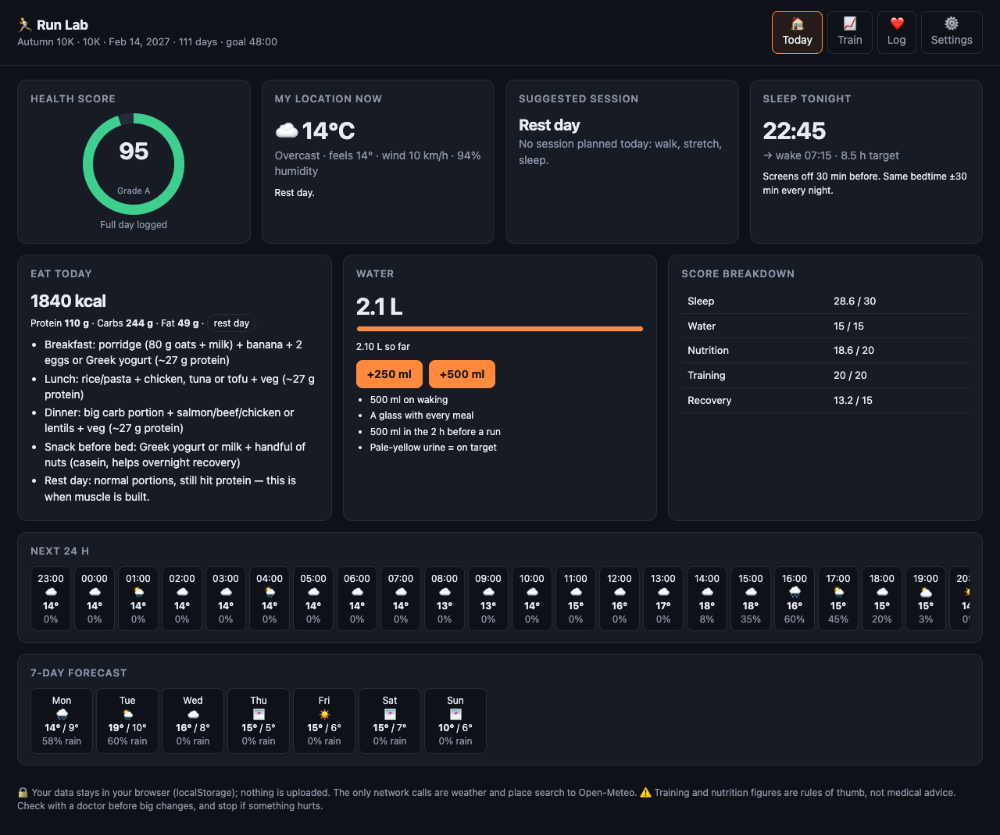
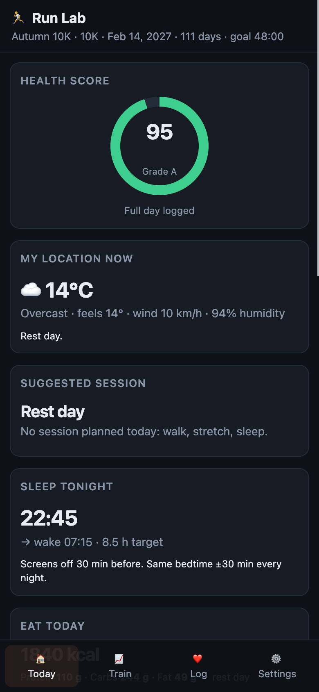
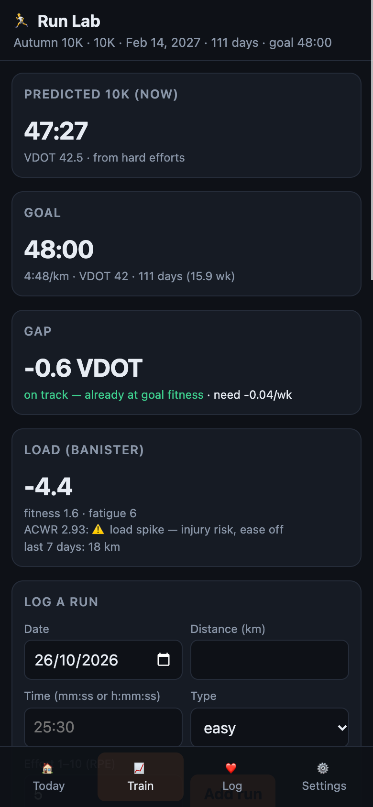

# Run Lab

A private, offline-first running coach that runs entirely in your browser.
Log your runs and how your day went; Run Lab estimates your current fitness,
predicts your race time, tracks training load, gives you training paces and a
week-by-week plan to race day, and sets daily food, water and sleep targets.

- **No account, no server, no tracking.** Your data lives in your browser's
  `localStorage` and never leaves the device.
- **Any goal race:** 5K, 10K, half marathon or marathon, with your own date and goal time.
- **Works offline** as an installable PWA. Only the weather needs a connection.
- Plain HTML, CSS and JavaScript: no framework, no build step, no dependencies.



 

## Run it locally

```sh
git clone <this repo> run-lab-web && cd run-lab-web
python3 -m http.server 8000
# open http://localhost:8000
```

Any static file host works (GitHub Pages, Netlify, an S3 bucket). The service
worker needs `http://localhost` or HTTPS; opening `index.html` from disk works
too, just without offline caching.

## How it works (the maths)

All of it is in [`js/model.js`](js/model.js) and [`js/health.js`](js/health.js).

**Fitness: VDOT (Daniels & Gilbert).** Each run of at least 1.5 km in the last
120 days is turned into a VDOT using the Daniels–Gilbert oxygen-cost equation
`VO2(v) = -4.60 + 0.182258·v + 0.000104·v²` (v in m/min) divided by the
fraction of VO2max sustainable for that duration,
`%max(t) = 0.8 + 0.1894393·e^(-0.012778·t) + 0.2989558·e^(-0.1932605·t)`.
Hard efforts (tempo, intervals, test, race, or RPE ≥ 7) are preferred; the top
three are averaged with a 30-day half-life recency weight. With only easy runs
the estimate is scaled up 8% and flagged as rough.

**Race prediction.** The time for your goal distance at that VDOT is found by
bisection on the same equations. Equivalent 5K/10K/half/marathon times are shown
too.

**Personal endurance (Riegel).** With hard efforts at two or more distances, a
least-squares fit of `log(time) = k·log(distance) + c` gives your own fade
exponent `k` (clamped to 1.0–1.2; Riegel's population value is 1.06), and
`T₂ = T₁·(D₂/D₁)^k` from your longest hard effort gives a second prediction.

**Training load (Banister impulse–response).** Daily load = minutes × RPE / 10.
Fitness is a 42-day and fatigue a 7-day exponentially weighted average; form =
fitness − fatigue. The acute:chronic workload ratio (last 7 days vs. the 28-day
weekly average) flags spikes above 1.5.

**Gap to goal.** Goal VDOT minus current VDOT, divided by weeks left, compared
with typical improvement rates (≤ 0.35 VDOT/week realistic, ≤ 0.55 ambitious).

**Paces.** Easy / long / threshold / interval paces at 66 / 70 / 88 / 98% of
VDOT (inverting the VO2 equation), plus race pace for your goal distance.

**Plan.** From your last-7-days volume: +10% per week, a cutback every 4th week,
a taper before race day (1 week for 5K–half, 2 for the marathon), with peak
weekly volume and long run capped by distance (5K 40/12 km, 10K 45/16, half
55/20, marathon 75/32). Phases: base, then threshold, then race-pace work.
Today's suggested session comes from that week: rest Monday and Friday, a
quality day Tuesday, easy runs, and the long run on Sunday.

**Daily targets.** Energy = Mifflin–St Jeor BMR
(`10·kg + 6.25·cm − 5·age + s`, s = +5 male, −161 female, midpoint if not given)
× 1.4 activity factor, + 1 kcal/kg/km run, ± 300 kcal for a gain/lose goal.
Protein 1.8 g/kg; carbohydrate 4 / 5 / 6.5 g/kg on rest / easy / long-or-hard
days; fat is the remainder (at least 0.8 g/kg). Water 35 ml/kg + 600 ml per hour
of running (+500 ml above 20 °C). Sleep target 8.5 h.

**Health score (0–100).** Sleep 30 (duration 24 + bedtime consistency 6),
water 15, nutrition 20 (protein 10 + energy 10), training 20, recovery 15
(resting HR vs. your 7-day baseline 8 + how you feel 7). Only the parts you log
count, and the score is rescaled and marked partial.

The JavaScript is a port of an earlier Python implementation kept in
[`test/reference/`](test/reference/). `node test/parity.mjs` runs both on the
same fixture (26 runs over 10 weeks, a profile and a week of day logs) and checks
1,000+ outputs agree to within 0.5% / 1 second. The test needs Node 18+ and Python 3.

## Privacy

- Everything you enter is stored under one `localStorage` key (`runlab.data`) in
  this browser. Clearing site data deletes it.
- **Settings → Export data** downloads a JSON backup; **Import data** restores it
  on another device or browser.
- The only network requests go to [Open-Meteo](https://open-meteo.com/) (free, no
  key): the forecast for the place you choose, and place-name search. Only that
  place's name and rounded coordinates are stored. "Use my location" rounds to
  about 1 km before saving or sending.
- No analytics, cookies, fonts, CDNs or third-party scripts. A Content Security
  Policy blocks connections to anything other than Open-Meteo.

## Not medical advice

The training and nutrition figures are general sports-science rules of thumb,
not medical or dietary advice. Talk to a doctor before big changes to training
or diet, especially with a health condition, and stop if something hurts.

## Files

```
index.html             app shell
css/app.css            light + dark theme
js/app.js              UI
js/model.js            VDOT, Riegel, Banister, paces, plan, suggested session
js/health.js           energy/macros/water targets, health score
js/store.js            localStorage schema, migration, export/import
js/weather.js          Open-Meteo forecast + geocoding
js/theme.js            applies the saved theme before first paint
sw.js                  offline cache for the app shell
manifest.webmanifest   PWA manifest
test/parity.mjs        JS vs. Python parity test
```

## License

[MIT](LICENSE)
